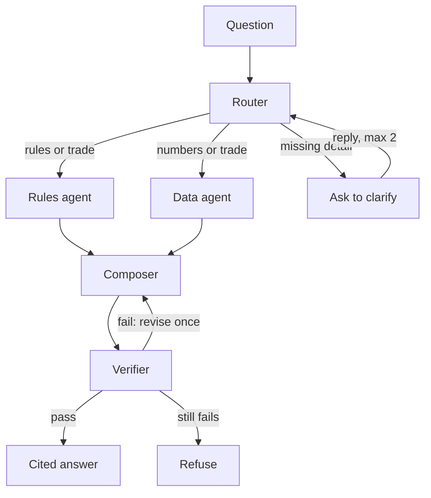

# NBA Cap and Trade Advisor

A multi-agent AI assistant that answers NBA salary cap and trade questions with cited, verified answers. Built for the Toronto Raptors front office as the example client.

Ask a question in plain English, like *"Can we trade Jakob Poeltl for Dyson Daniels?"*, and it returns the rule from the NBA's Collective Bargaining Agreement (CBA), the salary numbers for both teams, and a citation you can check. If it can't support an answer, it says so instead of guessing.

## Why

The 2023 CBA is 676 pages, and every trade has to be checked against four salary lines: the cap, the tax line and two aprons. Checking one trade by hand means finding the right rules, pulling both teams' salaries and doing the math. This advisor does all three in a few seconds and shows its sources.

## How it works



| Part | Uses AI? | What it does |
|---|---|---|
| **Router** | No | Five keyword rules, checked in order. Sends the question to rules, data, both, or a clarifying question. |
| **Rules agent** | Only to reword | Searches the CBA. If the best match scores below 0.55, rewords the question once and searches again, then refuses if still weak. |
| **Data agent** | No | Team payroll, apron status, and a one-side trade check that runs once per team. All math is tested Python. |
| **Composer** | Yes | Writes the answer only from the retrieved CBA chunks and the data agent's numbers. Never calculates. |
| **Verifier** | Code, then AI | Checks every citation was provided, every dollar amount is in the data, then asks a second model call if the evidence supports the answer. |

The agents never call each other. They share one LangGraph state, so every step can be logged and tested on its own.

### Two workflows

- **Static:** runs every step for every question. No clarifying questions, no retries. A predictable baseline.
- **Dynamic (default):** the router picks only the steps a question needs, can ask for missing details, and gets one revise if the verifier rejects an answer.

Both use the same agents, tools and data.

### Guardrails

- Vague questions get a clarifying question (at most 2), not a guess.
- Weak searches get one reworded retry, then a refusal.
- Numbers come from code, never the model.
- Hard limits: 1 rewrite, 1 revise, 15 steps, 30 second timeout per model call, no new retries after 60 seconds. Any crash or timeout ends in a refusal.

## Data

**CBA (searched).** Only the sections relevant to cap and trade questions are kept, tagged `core` or `maybe`. The PDF's bookmarks are used to find each section, which is then split along the CBA's own structure (section, then (a), then (i)) into chunks of at most 230 tokens. Each chunk starts with its citation. That gives 799 chunks, embedded with `all-MiniLM-L6-v2` and stored in Chroma using cosine similarity. Search runs locally and offline.

**Contracts (calculated).** A Basketball Reference export with salaries for all 30 teams through 2031-32, as of Nov 5, 2026. The loader handles the file's encoding and formatting, removes 6 duplicate players, and keys on player ID because 13 names have damaged characters. That leaves 455 players in SQLite. The raw file is never edited.

**Cap figures.** The official 2026-27 cap, tax and apron numbers are stored in `src/config.py`.

## Results

25 scored eval questions with expected answers written from the CBA before any run (plus 4 known gaps tracked separately):

| Setup | Correct | Tokens (full eval) |
|---|---|---|
| **Dynamic, top-k 8 (final)** | **25/25** | 67,295 |
| Dynamic, top-k 5 | 24/25 | 50,916 |
| Dynamic, top-k 3 | 23/25 | 40,038 |
| Static, top-k 8 | 21/25 | 92,858 |

Every miss was a refusal, not a wrong answer. Static's misses were all vague questions it can't ask about. Results are saved in `eval/results/`.

The code is also covered by 216 unit tests, with Gemini faked so they run fast and free.

## Setup

Requires Python 3.14 and a Gemini API key from Google AI Studio.

```bash
python -m venv .venv
source .venv/bin/activate
pip install -r requirements.txt
```

Create a `.env` file in the project root:

```
GEMINI_API_KEY=your_key_here
```

The source files aren't in the repo. Place them in `data/raw/`:

- `NBA_CBA.pdf`: the 2023 NBA Collective Bargaining Agreement
- `NBA_Player_Salaries.csv`: the Basketball Reference contracts export

Then build the database and the vector store:

```bash
python -m src.ingest.contracts
python -m src.ingest.build_vectorstore
```

## Usage

```bash
python -m src.main "How long after signing can a draft rookie be traded?"
python -m src.main "What is the Raptors payroll?" --mode static
python -m src.main "Can we trade him?"
```

| Option | Meaning |
|---|---|
| `--mode static\|dynamic` | Which workflow to run (default: dynamic) |
| `--top-k N` | How many CBA chunks the composer sees (default: 8) |
| `--tier core\|maybe` | Only search one tier of the CBA |
| `--show-chunks` | Print the retrieved chunks and any reworded search |

Run the eval and the unit tests:

```bash
python -m eval.run_eval              # makes real Gemini calls
python -m pytest
```

## Project structure

```
src/
  agents/      router, rules agent, data agent, composer, verifier
  graph/       static and dynamic LangGraph workflows
  ingest/      CBA chunking, vector store build, contracts loader
  tools/       CBA search, contract queries, Gemini setup
  config.py    models, cap figures, thresholds and limits
  main.py      command line interface
eval/          questions, harness, saved results
tests/         unit tests
```

## Limitations

- Command line only.
- Contract data isn't an official payroll. Summed salaries miss dead money and cap holds, and duplicate players can land on the wrong team.
- Covers the 2026-27 season only.
- The keyword router can miss phrasings it doesn't know. Next step: an LLM classifier when no rule matches.
- The eval is small, and each setting was run once.

## Built with

Python, LangGraph, Gemini (3.8 Flash for writing and verifying, 3.5 Flash Lite for rewording), Chroma, sentence-transformers, SQLite and PyMuPDF.

Built with help from Claude (Anthropic) for explanations, code review, tests and documentation. Design decisions and trade-offs are my own.
